<div align="center">

# 🥔 Producao_batatas

### Uma fábrica de batatas em 3D, ao vivo no navegador — e um ERP que responde as perguntas de cada gestor com os dados dela.


<br>

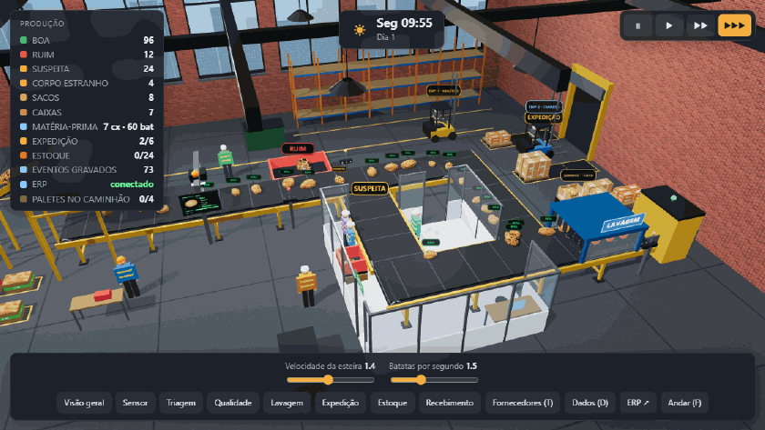

<sub>A linha inteira rodando em tempo real: esteira, sensor, triagem, sala de qualidade, lavagem, descasque, embalagem e expedição.</sub>

</div>

---

## 📖 Índice

- [O problema de negócio](#-o-problema-de-negócio)
- [O que tem aqui](#-o-que-tem-aqui)
- [Simulador 3D — um tour](#-simulador-3d--um-tour)
- [Os setores da empresa](#-os-setores-da-empresa)
- [Potato ERP — as perguntas dos gestores](#-potato-erp--as-perguntas-dos-gestores)
- [Dados com problemas de verdade](#-dados-com-problemas-de-verdade)
- [Como rodar](#-como-rodar)
- [Arquitetura](#-arquitetura)
- [Estrutura do repositório](#-estrutura-do-repositório)
- [Decisões técnicas](#-decisões-técnicas)
- [Roadmap](#-roadmap)

---

## 🎯 O problema de negócio

Uma linha de produção de batatas tem **uma única esteira**: as batatas caem nela, passam por um **sensor óptico** e são classificadas como **BOA**, **RUIM** ou **SUSPEITA**. As boas seguem para lavagem e embalagem; as ruins vão para o descarte; as suspeitas vão para a **sala de qualidade**, onde inspetores humanos dão o veredito final.

Em volta dessa linha existe uma empresa inteira — laboratório, armazém refrigerado, oficina, pedidos de clientes — e cada gestor quer uma resposta diferente:

| Quem pergunta | O que quer saber |
|---|---|
| 🏭 **Gerente de produção** | Quantas batatas por hora saem? Algum turno produz menos ou erra mais? Quanto se perde no descasque? |
| 🔬 **Qualidade** | O classificador acerta nas suspeitas? **Por que um lote rende pior?** Se um lote for contaminado, para onde ele foi? |
| 🛒 **Compras** | Qual fornecedor entrega a melhor matéria-prima — e o laboratório confirma? |
| 📈 **Diretoria** | Entregamos os pedidos no prazo? Quanto a fábrica consome de energia e água por kg? Para onde vai o refugo? |
| 🔧 **Manutenção** | O sensor está descalibrando? A refrigeração falhou? Quanto tempo leva para consertar e por quê? |

Este projeto responde isso de ponta a ponta: **gera** os dados com uma simulação 3D viva, **coleta** num ERP e **mostra** cada resposta com o SQL que a produziu.

---

## 🧩 O que tem aqui

<table>
<tr>
<td width="50%" valign="top">

### 🎮 Simulador 3D
`simulacao-3d/`

Uma fábrica inteira em **Three.js**, num único arquivo HTML, em estilo de jogo de gestão (inspirado em *Big Ambitions*). Tem gente, empilhadeiras, defeitos, quebras, dia/noite e **nove setores** em volta da linha. Abre com dois cliques — sem instalar nada.

</td>
<td width="50%" valign="top">

### 🗄️ Potato ERP
`erp/`

Servidor **Node + SQLite** que recebe os eventos do simulador **em tempo real**, guarda tudo e serve telas técnicas por público e por setor. O título de cada gráfico é a **pergunta de negócio**; um clique mostra o **SQL**.

</td>
</tr>
</table>

---

## 🎮 Simulador 3D — um tour

Tudo é gerado por código (geometria procedural e texturas em canvas): não há modelos nem imagens externas. Use os botões da barra inferior para mudar de câmera.

### 1. Do sensor à triagem

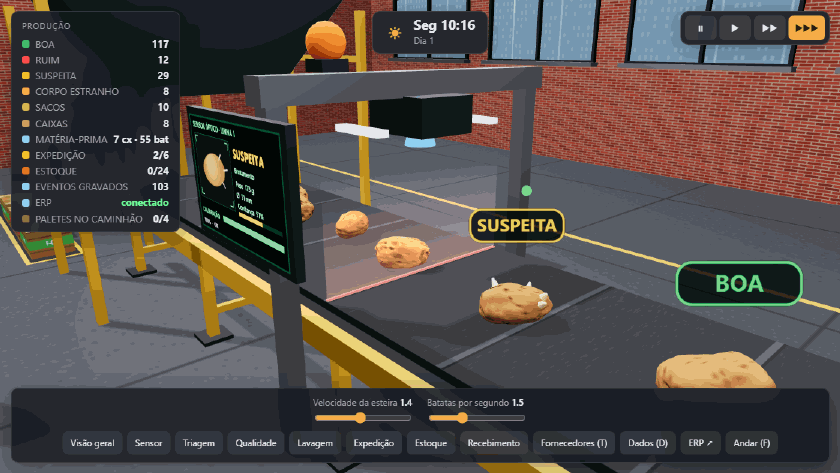

Cada batata passa pelo **sensor**, que lê peso, diâmetro, cor, área de defeito e corpos estranhos (pedras e torrões). A tela do sensor mostra a leitura, e jatos de **ar comprimido** separam as batatas para cada destino. Se o sensor descalibra, ele passa a errar — e um **técnico** vem consertar.

### 2. Sala de qualidade: humanos no circuito

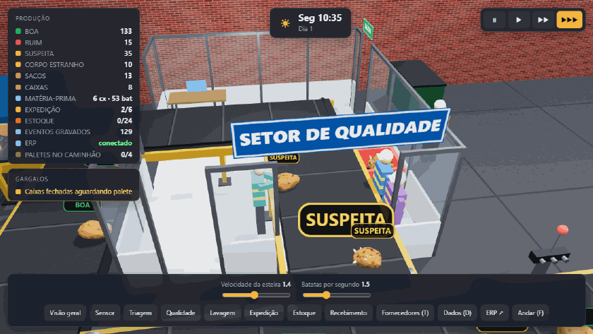

As batatas **SUSPEITAS** são desviadas para uma sala envidraçada, onde **inspetores** decidem BOA ou RUIM. As aprovadas voltam para a esteira; as reprovadas vão para a caixa de descarte, levadas por um funcionário. O rótulo final fica registrado como dado tardio — exatamente o que um classificador de ML usaria para aprender. **À noite há menos inspetores, e eles erram mais.**

### 3. Expedição com duas empilhadeiras trabalhando em paralelo

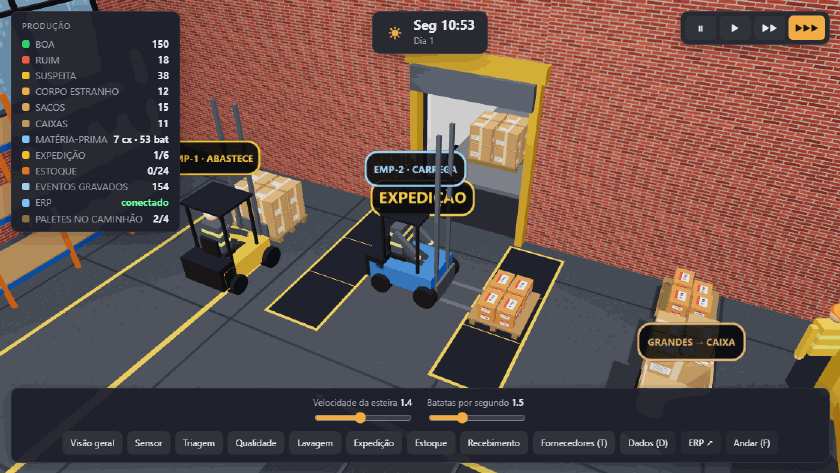

As batatas são separadas por **calibre**: as grandes vão para **caixas**, as pequenas para **sacos**. Os paletes são montados e duas empilhadeiras fazem trabalhos diferentes sem se atrapalhar:

- **EMP-1 · ABASTECE** leva os paletes prontos para a área de expedição e para as prateleiras de **estoque**;
- **EMP-2 · CARREGA** pega da expedição e carrega o **caminhão** na doca.

### 4. Recebimento de fornecedores

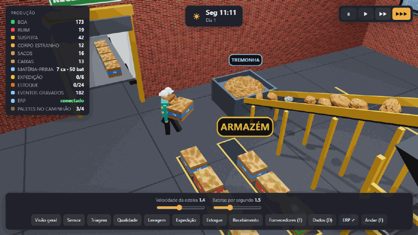

Os caminhões dos fornecedores chegam, as **caixas** são descarregadas no armazém de matéria-prima e um alimentador inclinado leva as batatas até a **tremonha** que abastece a esteira.

### 5. Fornecedores: quem entrega as melhores batatas?

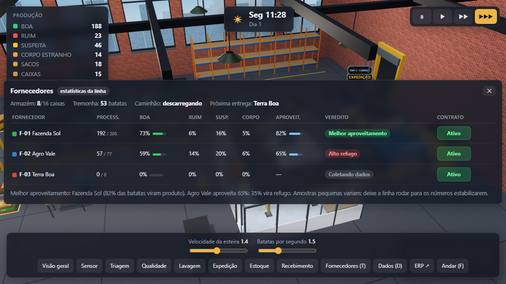

O painel **Fornecedores (T)** compara, em tempo real, a qualidade do que cada um entrega (BOA, RUIM, suspeitas, corpos estranhos e **aproveitamento**), dá um **veredito** e deixa **suspender o contrato** — o próximo caminhão passa a vir de outro fornecedor.

### E mais

| Recurso | Como usar |
|---|---|
| 🔎 **Ficha da batata** | Clique em qualquer batata: lote, fornecedor, peso, diâmetro, cor, defeitos, classificação e confiança |
| 🎥 **Seguir uma batata** | Na ficha, *Seguir esta batata* — a câmera acompanha ela pela fábrica |
| 🚶 **Andar pelo galpão** | Tecla **F** (WASD + mouse), em primeira pessoa |
| ⚠️ **Alertas de gargalo** | Mesa de sacos cheia, tremonha vazia, esteira travada, armazém quente, oficina sem peça, pedido atrasado… |
| 🌗 **Dia e noite** | Relógio da fábrica: 1 s real = 1 min simulado a 1x |
| ⏩ **Velocidades** | Pausa (espaço), 1x, 2x e 3x |

---

## 🏢 Os setores da empresa

Além da linha, a fábrica tem setores que geram **dados próprios** e respondem perguntas que a linha sozinha não responde. Todos aparecem no 3D, têm botão de câmera e painel, e alimentam o ERP.

### 🔬 Laboratório — *por que um lote rende pior?*

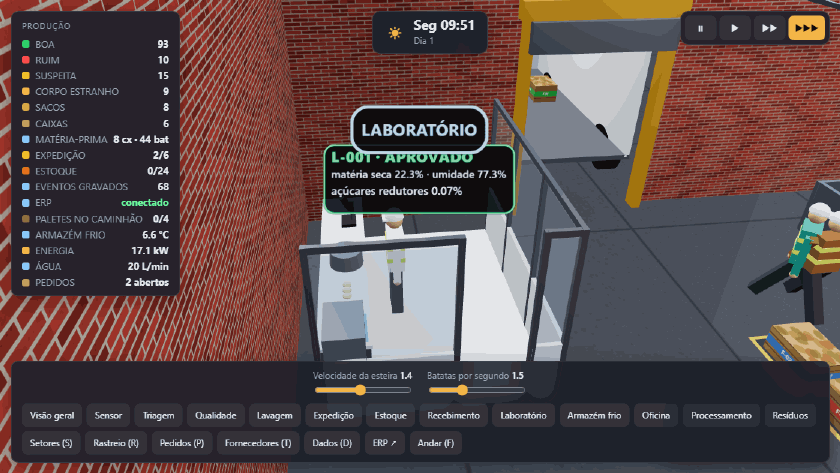

Quando o caminhão chega, uma técnica de jaleco analisa o lote: **matéria seca, açúcares redutores e umidade**. O resultado vira **APROVADO**, **RESSALVA** ou **REPROVADO** e está ligado à qualidade real do lote — lotes com mais açúcar geram mais refugo. No ERP, um gráfico de dispersão mostra essa correlação.

### ❄️ Armazém frio — *quanto a matéria-prima sofreu?*

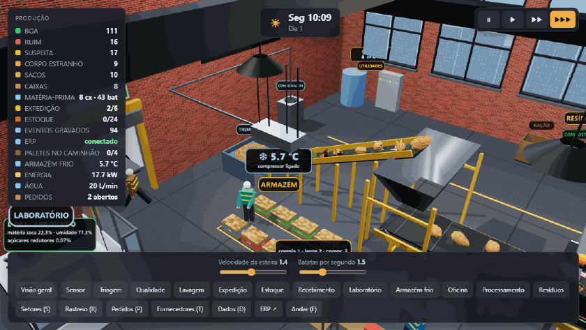

O armazém tem **evaporador, condensador, termostato e temperatura ao vivo**. As caixas **envelhecem e deterioram** (mais rápido quando esquenta), saem pelo **primeiro que entra, primeiro que sai** e, se a deterioração passa do limite, são **descartadas**. Quando o compressor quebra, ninguém percebe de imediato: a temperatura sobe, dispara o alarme e o técnico é chamado.

### 🔧 Oficina e peças — *onde se perde tempo numa falha?*

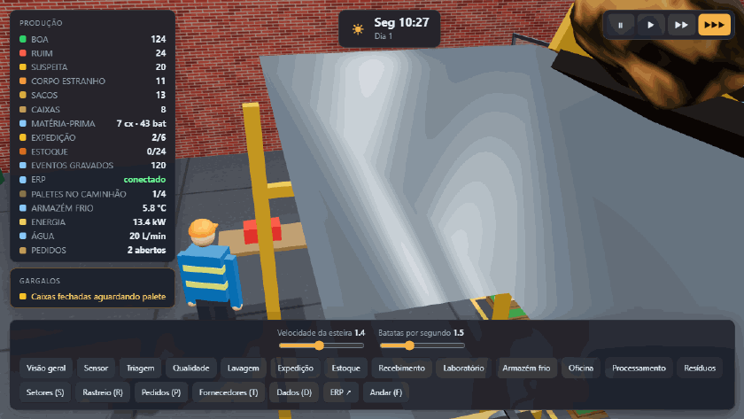

Há três tipos de falha (esteira travada, sensor descalibrado, refrigeração parada) e o técnico precisa de uma **peça** da prateleira. Quando o estoque cai, a oficina **pede reposição** — e, se a peça faltar, a fábrica espera. O ERP separa o tempo de cada falha em **percepção, deslocamento, espera de peça e reparo**, e calcula **MTBF** e **MTTR**.

### ✂️ Processamento — *quanto vira produto?*

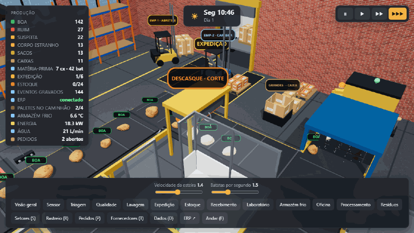

As batatas de **calibre grande** passam por um portal de **descasque e corte** sobre a esteira. A casca e as aparas saem do peso, e o ERP mostra o **rendimento etapa por etapa** (entrada → casca → aparas → produto), por lote e por hora.

### ♻️ Resíduos, ⚡ utilidades, 👥 turnos e 📦 pedidos

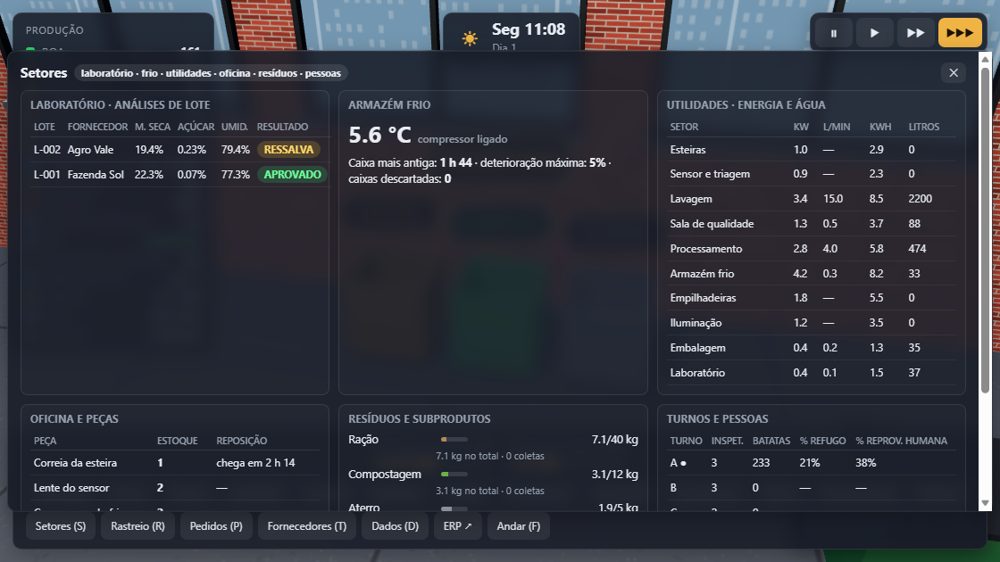

O painel **Setores (S)** reúne o que não precisa de uma câmera própria:

- **Resíduos:** o que não vira produto é separado em **ração**, **compostagem** e **aterro** (pedras e torrões vão para o aterro, batatas podres para a compostagem), com coletas quando a caçamba enche.
- **Energia e água:** cada setor consome kW e litros conforme trabalha — a lavagem e o frio pesam mais; a noite gasta mais com iluminação.
- **Turnos e pessoas:** turnos A, B e C trocam sozinhos; à noite há 2 inspetores em vez de 3, com mais cansaço e mais erro.
- **Pedidos e entregas (P):** clientes fazem pedidos com prazo, e cada caminhão que sai **abate os mais urgentes**. Há pedidos urgentes e atrasos de verdade.

<table>
<tr>
<td width="50%">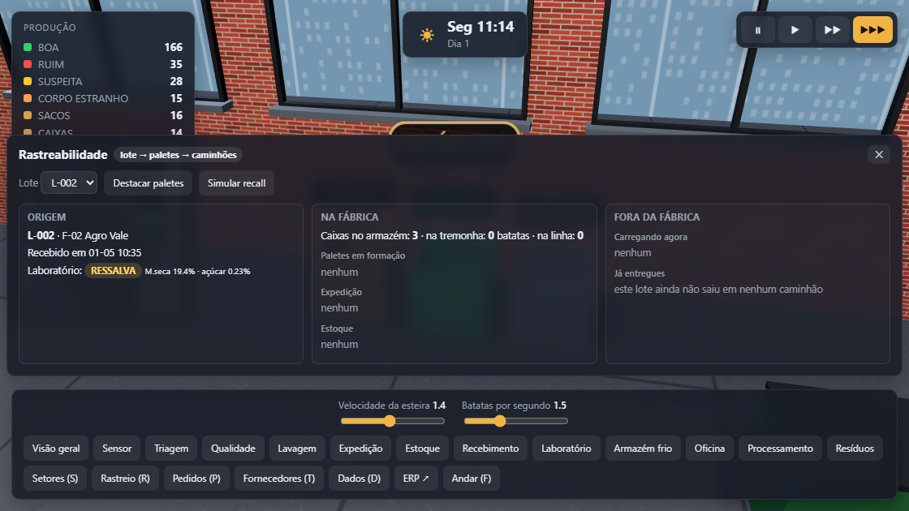<br><sub><b>Rastreio (R)</b> — escolha um lote e veja onde estão os paletes dele, na fábrica ou já no caminhão. <i>Simular recall</i> destaca os paletes no 3D.</sub></td>
<td width="50%">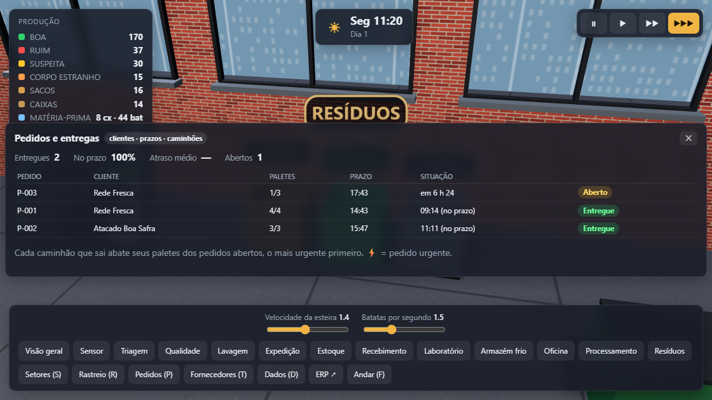<br><sub><b>Pedidos (P)</b> — prazos, entregas no prazo e atrasos.</sub></td>
</tr>
</table>

---

## 🗄️ Potato ERP — as perguntas dos gestores

<div align="center">
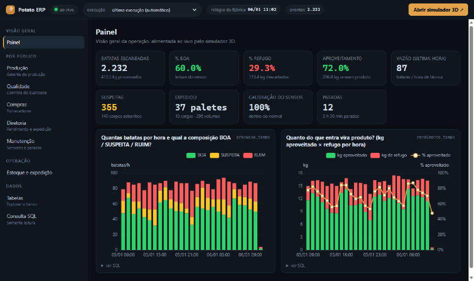
</div>

O ERP é uma tela técnica e escura, uma página por público e uma por setor. **Cada gráfico tem como título a pergunta de negócio** e, embaixo, o botão **ver SQL** com a consulta exata que gerou a resposta. As telas se atualizam sozinhas enquanto o simulador roda (Server-Sent Events).

<table>
<tr>
<td width="50%"><br><sub><b>Painel</b> — visão geral da operação ao vivo.</sub></td>
<td width="50%">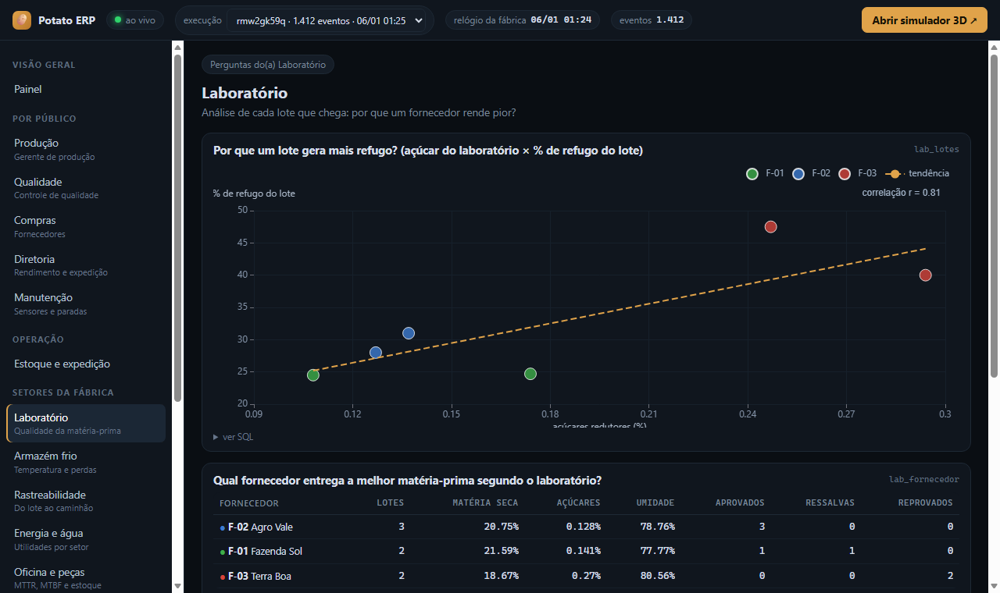<br><sub><b>Laboratório</b> — o açúcar do lote explica o refugo.</sub></td>
</tr>
<tr>
<td width="50%">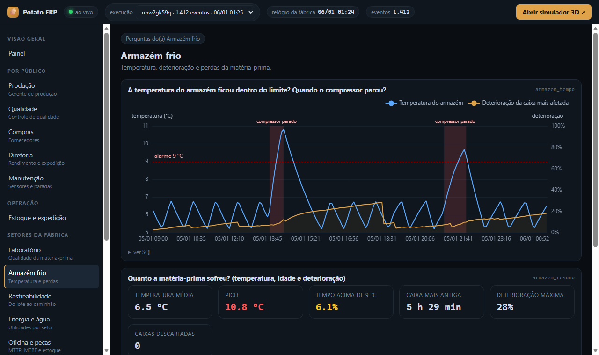<br><sub><b>Armazém frio</b> — quando o compressor parou e quanto custou.</sub></td>
<td width="50%">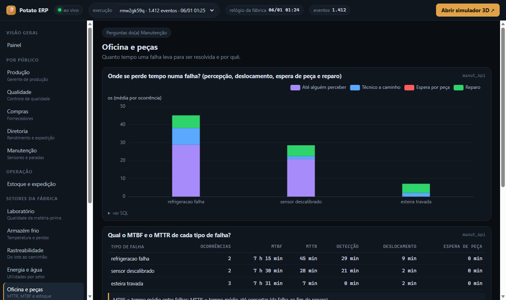<br><sub><b>Oficina e peças</b> — percepção, deslocamento, espera de peça e reparo.</sub></td>
</tr>
<tr>
<td width="50%">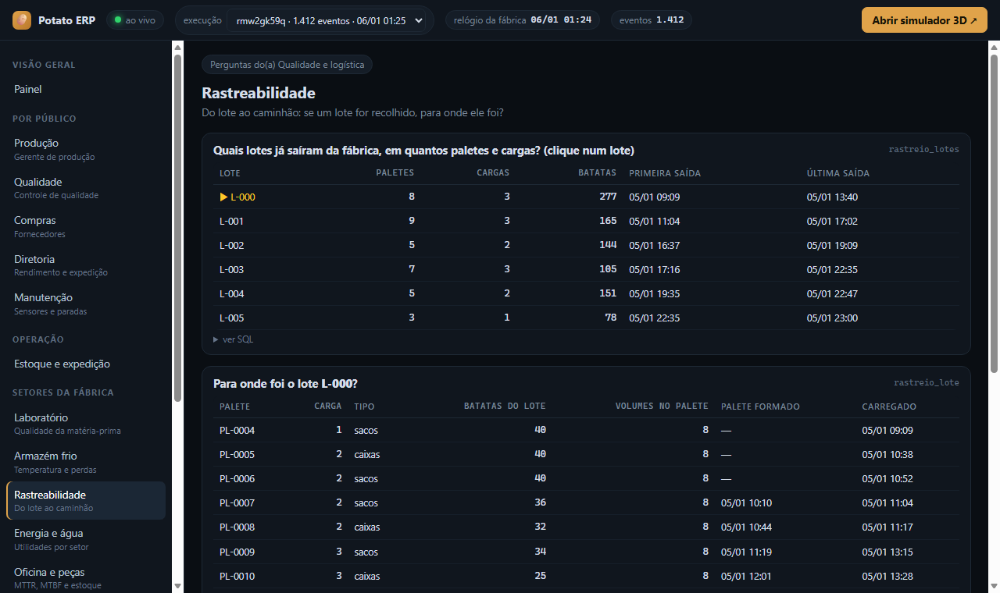<br><sub><b>Rastreabilidade</b> — do lote ao caminhão.</sub></td>
<td width="50%">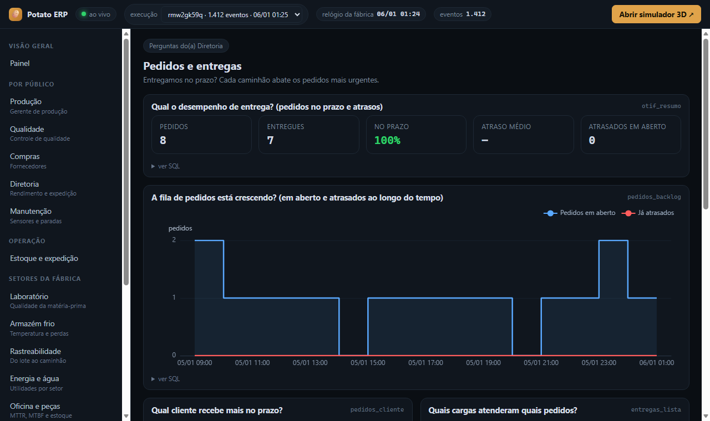<br><sub><b>Pedidos e entregas</b> — prazos, backlog e OTIF.</sub></td>
</tr>
<tr>
<td width="50%">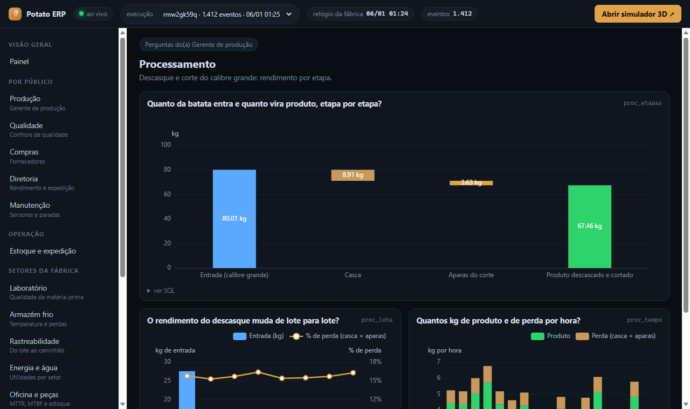<br><sub><b>Processamento</b> — o que entra e o que vira produto.</sub></td>
<td width="50%">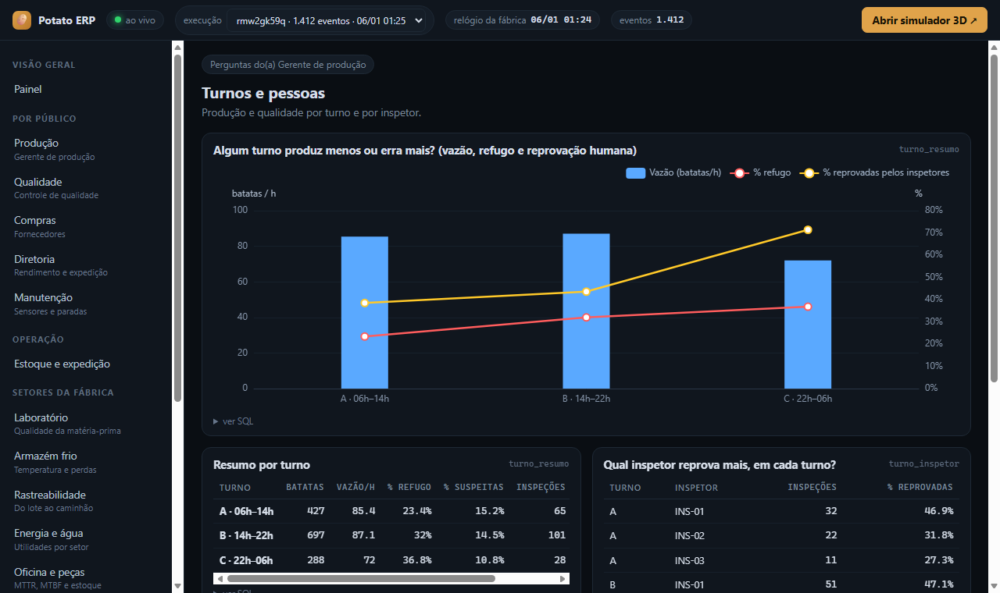<br><sub><b>Turnos e pessoas</b> — o turno da noite produz menos e erra mais?</sub></td>
</tr>
<tr>
<td width="50%">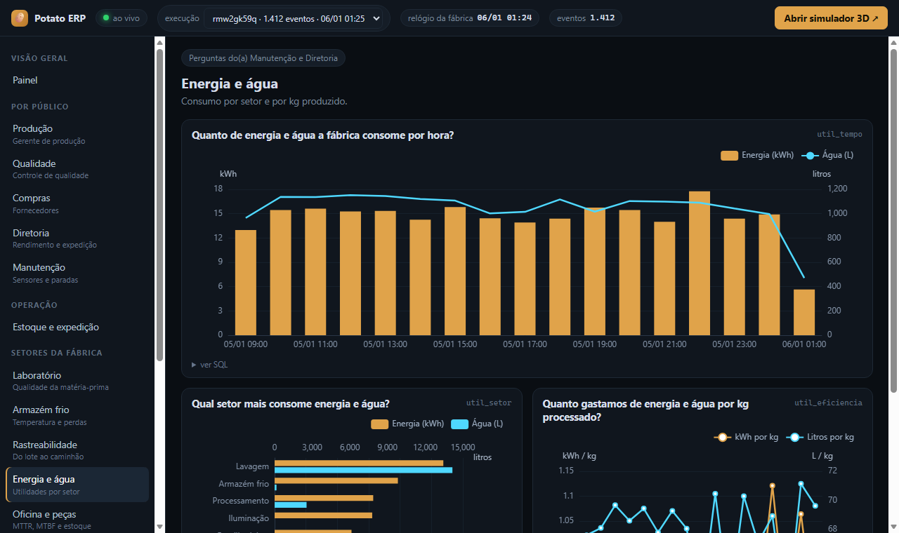<br><sub><b>Energia e água</b> — por setor e por kg.</sub></td>
<td width="50%">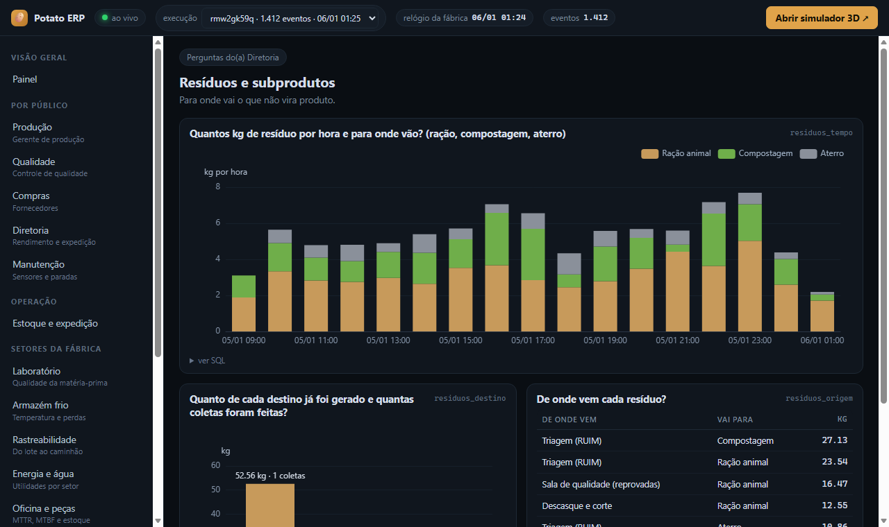<br><sub><b>Resíduos</b> — para onde vai o que não vira produto.</sub></td>
</tr>
</table>

### Perguntas respondidas, por público

| Público | Pergunta | Consulta |
|---|---|---|
| Gerente de produção | Quantas batatas por hora e qual o % BOA/RUIM/SUSPEITA? | `producao_tempo`, `producao_turno` |
| | A produção caiu? Foi parada de equipamento? | `producao_tempo` + `paradas` |
| | Algum turno produz menos ou erra mais? | `turno_resumo`, `turno_inspetor`, `turno_paradas` |
| | Quanto da batata vira produto depois do descasque e do corte? | `proc_etapas`, `proc_lote`, `proc_tempo` |
| Qualidade | Qual lote/fornecedor tem o maior refugo e qual a tendência? | `refugo_lote` |
| | O classificador acerta nas SUSPEITAS? (confiança × rótulo final) | `confusao_suspeitas` |
| | O sensor está superestimando suspeitas? | `aprovacao_tempo` + `calibracao` |
| | **Por que um lote rende pior?** (açúcar × refugo) | `lab_lotes`, `lab_fornecedor` |
| | **Se um lote for recolhido, para onde foi?** | `rastreio_lotes`, `rastreio_lote`, `rastreio_cargas`, `recalls_lista` |
| Compras | Qual fornecedor entrega o maior aproveitamento do peso? | `fornecedores` |
| Diretoria | Qual o rendimento ao longo do tempo? Quanto foi expedido? | `rendimento_tempo`, `expedicao_tempo` |
| | Entregamos no prazo? A fila de pedidos cresce? | `otif_resumo`, `pedidos_backlog`, `pedidos_cliente` |
| | Quanto gastamos de energia e água por kg? | `util_tempo`, `util_setor`, `util_eficiencia` |
| | Para onde vai o que não vira produto? | `residuos_tempo`, `residuos_destino`, `residuos_origem` |
| Manutenção | O sensor está descalibrando? (média móvel e desvio do `cor_matiz`) | `sensor_cor` + `calibracao` |
| | Quantas paradas e quanto tempo parado? | `paradas` |
| | Onde se perde tempo numa falha? MTBF e MTTR? | `manut_kpi`, `pecas_eventos`, `pecas_consumo` |
| | A temperatura do armazém ficou dentro do limite? | `armazem_tempo`, `armazem_resumo`, `armazem_perdas` |

Além das telas há o **explorador de tabelas** e uma **Consulta SQL** livre (somente leitura, `SELECT`/`WITH`, no máximo 500 linhas).

> Por enquanto o projeto trata **só de produção e operação** — não há preços, custos, receita nem caixa. A camada financeira fica para uma etapa futura.

---

## 🧪 Dados com problemas de verdade

Dados limpos não ensinam nada. O botão **Dados (D)** do simulador gera um **pacote** pronto para uma camada *Bronze*, com problemas **injetados de propósito** e taxas ajustáveis:

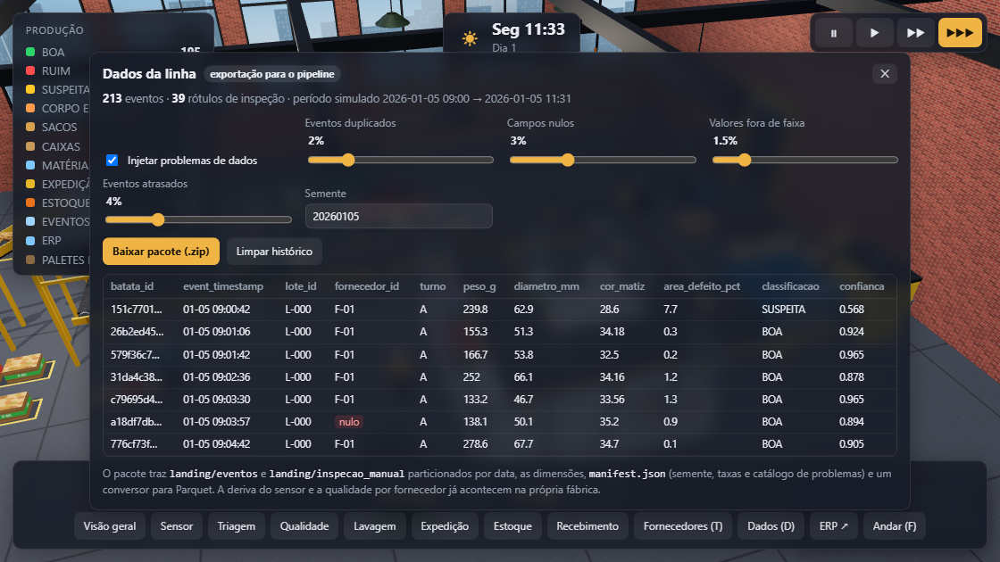

| Problema | Como aparece | Como tratar |
|---|---|---|
| **Eventos duplicados** | mesmo `batata_id` com `event_timestamp` alguns segundos depois | manter o registro mais recente |
| **Campos nulos** | um campo do evento vem vazio | validar e mandar à quarentena |
| **Valores fora de faixa** | peso negativo, diâmetro > 200, confiança fora de 0..1, cor > 360… | regra de faixa → quarentena com o motivo |
| **Eventos atrasados** | fora de ordem no arquivo ou no arquivo do dia seguinte | reordenar por `event_timestamp` |
| **Deriva do sensor** | `cor_matiz` sobe e a classificação erra quando a calibração cai | média móvel e desvio por sensor |
| **Qualidade por fornecedor e por lote** | cada fornecedor — e cada lote — entrega uma qualidade diferente | taxa de refugo por fornecedor/lote, ligada ao laboratório |
| **Dado tardio** | rótulo final das SUSPEITAS chega horas depois | join com `inspecao_manual` |
| **Falha de refrigeração** | a temperatura sobe sem ninguém perceber e as caixas deterioram | cruzar `armazem_temp` com o refugo dos lotes |

O pacote (`.zip`) traz `landing/eventos/data=AAAA-MM-DD/`, `landing/inspecao_manual/`, `landing/dimensoes/`, as **tabelas dos setores** em `landing/operacao/` (laboratório, armazém frio, rastreio, utilidades, peças, resíduos, processamento, pedidos, entregas, escala, recalls), um `manifest.json` (semente, taxas, contagens reais) e um conversor para **Parquet**. A injeção usa uma **semente**: mesma semente, mesmos dados.

---

## 🚀 Como rodar

### Só o simulador (sem instalar nada)

Dê dois cliques em [`simulacao-3d/index.html`](simulacao-3d/index.html). Funciona direto do arquivo, em qualquer navegador moderno.

### Simulador + ERP

Requer **Node.js 22.5 ou mais novo** (o SQLite já vem embutido; **não há `npm install`**).

```bash
git clone https://github.com/matheuszovisk255/Producao_batatas.git
cd Producao_batatas/erp
node server.js            # ou, no Windows, dois cliques em iniciar.bat
```

| Endereço | O que é |
|---|---|
| http://localhost:3000/ | o **ERP** (painéis e consultas) |
| http://localhost:3000/sim/ | o **simulador 3D**, já ligado ao ERP |

Abra o simulador, ponha na velocidade **3x** e acompanhe os gráficos do ERP se encherem. O simulador também funciona aberto direto do arquivo: ele envia os dados para `localhost:3000` se o servidor estiver no ar; se não estiver, a simulação segue normal e os dados esperam numa fila. Os dados ficam em `erp/dados/erp.db` e sobrevivem a reinicializações (bancos de versões anteriores são migrados sozinhos).

**Atalhos no simulador:** `S` setores · `R` rastreio · `P` pedidos · `T` fornecedores · `D` dados · `F` andar · `espaço` pausa · `1`–`8` câmeras.

---

## 🏗️ Arquitetura

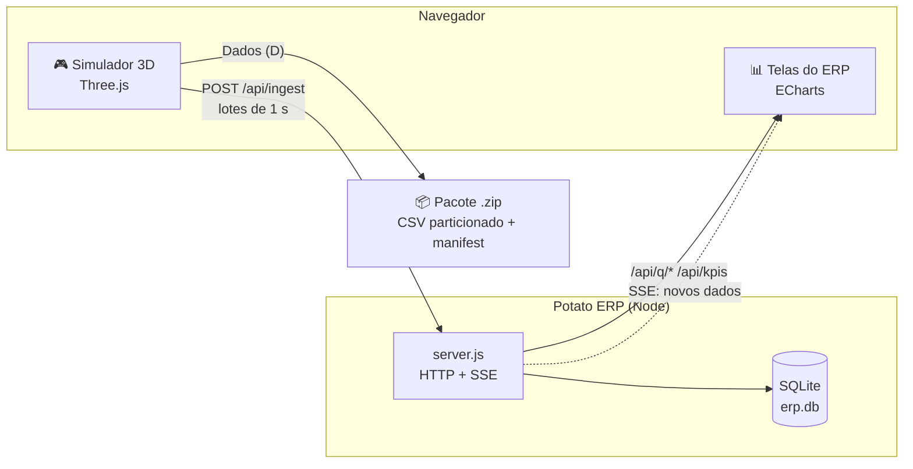

- **Ingestão:** o simulador agrupa o que acontece na fábrica e envia a cada segundo. Cada execução recebe um `run_id`; as telas mostram a última por padrão, com seletor para as anteriores.
- **Tempo real:** o servidor avisa as telas abertas por *Server-Sent Events*.
- **Tempo simulado:** todos os horários são da "fábrica" (1 s a 1x = 1 min), a partir de 05/01/2026 09:00.
- **Modelo de dados:** `eventos` (uma linha por batata lida), `compras`, `expedicao`, `manutencao`, `sensor_saude`, `estoque_snap`, `dim_fornecedores`, `runs` e as tabelas dos setores: `lab_analises`, `armazem_temp`, `armazem_perdas`, `rastreio`, `utilidades`, `pecas`, `residuos`, `processamento`, `pedidos`, `entregas`, `escala`, `recalls`.

---

## 📁 Estrutura do repositório

```
Producao_batatas/
├── simulacao-3d/
│   ├── index.html          # a fábrica inteira (Three.js), em um único arquivo
│   └── lib/three.min.js
├── erp/
│   ├── server.js           # API, SQLite, consultas analíticas, SSE
│   ├── public/             # interface do ERP (ECharts local)
│   ├── iniciar.bat         # atalho para Windows
│   └── README.md           # detalhes do ERP e da API
├── docs/media/             # GIFs e capturas deste README
└── projeto-batata.txt      # a ideia original do projeto (portfólio de dados)
```

---

## 🧠 Decisões técnicas

- **Um único HTML para o simulador.** Sem build, sem bundler: abre com dois cliques e é fácil de compartilhar. Tudo (geometria e texturas) é procedural.
- **`node:sqlite` embutido.** O ERP não tem dependências: nada de `npm install`, nada de driver nativo.
- **Tabelas dos setores definidas num só lugar.** Cada tabela nova é declarada uma vez no servidor (colunas, chave) e a criação, a gravação e a listagem saem dela.
- **SQL à vista.** Cada gráfico mostra a consulta que o gerou — a análise é auditável, não uma caixa-preta.
- **Causa e efeito de verdade.** A qualidade oculta de cada lote alimenta tanto o refugo da linha quanto as medidas do laboratório; a temperatura do armazém alimenta a deterioração e esta alimenta o refugo. As análises do ERP têm o que descobrir.
- **Dados limpos no ERP, sujos no pacote.** O ERP registra fatos como um sistema transacional; os problemas de dados ficam no pacote de exportação, onde pertencem à camada Bronze.
- **Reprodutibilidade.** A injeção de problemas usa uma semente (`mulberry32`): a mesma semente gera o mesmo pacote.
- **Somente leitura no console SQL.** Só `SELECT`/`WITH`, com limite de linhas, para explorar sem risco.

---

## 🗺️ Roadmap

Este repositório é a base de um projeto maior de **engenharia e análise de dados**. Os próximos passos planejados:

- [ ] **Pipeline medalhão** com **DuckDB + dbt** (Bronze → Silver → Gold), com testes `unique`, `not_null`, `accepted_values`, `relationships` e regras de negócio
- [ ] **Quarentena** de registros inválidos, com o motivo da rejeição
- [ ] **App Streamlit** lendo apenas a camada Gold, uma página por público
- [ ] Camada **financeira** (preço/kg, custo de energia e peças, perdas e margem) de volta ao projeto
- [ ] **CI** com lint, testes e `dbt build` em amostra pequena
- [ ] **Streaming** com Redpanda e orquestração com Airflow/Dagster
- [ ] **Ciência de dados:** detecção de drift, previsão de refugo por lote (açúcar + temperatura), manutenção preditiva e reclassificação de suspeitas com ML

---

<div align="center">

Feito com 🥔 e curiosidade por **[@matheuszovisk255](https://github.com/matheuszovisk255)**

</div>
