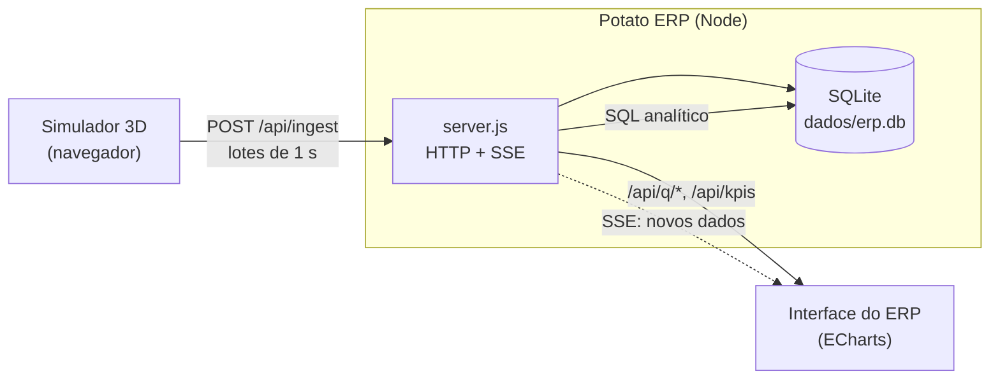

# Potato ERP

ERP local que recebe, em tempo real, os eventos do **simulador 3D** da linha de batatas
(`../simulacao-3d`), guarda tudo em **SQLite** e responde as perguntas de cada gestor
com telas técnicas. Cada gráfico tem como título a pergunta de negócio e mostra o SQL que a responde.

## Como rodar

Requer **Node.js 22.5 ou mais novo** (o SQLite vem embutido; não há `npm install`).

```
cd erp
node server.js          (ou dê dois cliques em iniciar.bat)
```

| Endereço | O que é |
|---|---|
| http://localhost:3000/ | o ERP (painéis e consultas) |
| http://localhost:3000/sim/ | o simulador 3D, já ligado ao ERP |

O simulador também funciona aberto direto do arquivo (`simulacao-3d/index.html`): ele envia os dados
para `http://localhost:3000` se o servidor estiver no ar. Se o ERP estiver desligado, a simulação segue
normal e os dados esperam numa fila até ele voltar. No simulador, o botão **ERP ↗** abre o ERP e a linha
"ERP" do painel mostra se a conexão está ativa.

Os dados ficam em `erp/dados/erp.db` e sobrevivem a reinicializações. Para zerar: tela **Tabelas →
Apagar todos os dados do ERP** ou apague a pasta `dados/`.

## Arquitetura



- **Ingestão:** o simulador agrupa o que acontece na fábrica e envia a cada segundo. Cada execução do
  simulador recebe um `run_id`; as telas mostram a última por padrão e há um seletor para as anteriores.
- **Tempo real:** o servidor avisa as telas abertas por Server-Sent Events e elas se atualizam sozinhas.
- **Tempo simulado:** todos os horários são da "fábrica" (1 segundo real a 1x = 1 minuto simulado),
  começando em 05/01/2026 09:00.

## Modelo de dados

| Tabela | Conteúdo |
|---|---|
| `eventos` | uma linha por batata lida pelo sensor (peso, diâmetro, `cor_matiz`, defeito, classificação, confiança) + rótulo final do inspetor |
| `compras` | lotes recebidos dos fornecedores (caixas e batatas) |
| `expedicao` | paletes carregados nos caminhões (tipo e volumes) |
| `manutencao` | ordens de serviço: esteira travada e sensor descalibrado, com início e fim |
| `sensor_saude` | calibração do sensor a cada 5 s de simulação |
| `estoque_snap` | níveis de matéria-prima, tremonha, expedição e estoque acabado |
| `dim_fornecedores` | código e nome do fornecedor |
| `runs` | execuções do simulador |

## Perguntas respondidas, por público

| Público | Pergunta | Consulta |
|---|---|---|
| Gerente de produção | Quantas batatas por hora e qual o % BOA/RUIM/SUSPEITA? | `producao_tempo`, `producao_turno` |
| | A produção caiu? Foi parada de equipamento? | `producao_tempo` + `paradas` |
| Qualidade | Qual lote/fornecedor tem o maior refugo e qual a tendência? | `refugo_lote` |
| | O classificador acerta nas SUSPEITAS? (confiança × rótulo final) | `confusao_suspeitas` |
| | O sensor está superestimando suspeitas? | `aprovacao_tempo` + `calibracao` |
| Compras | Qual fornecedor entrega o maior aproveitamento do peso? Qual gera mais refugo, suspeitas e corpos estranhos? | `fornecedores` |
| Diretoria | Qual o rendimento da fábrica ao longo do tempo? Quanto foi expedido por hora e quais cargas saíram? | `rendimento_tempo`, `expedicao_tempo`, `expedicao_lista` |
| Manutenção | O sensor está descalibrando? (média móvel e desvio do `cor_matiz`) | `sensor_cor` + `calibracao` |
| | Quantas paradas e quanto tempo parado? | `paradas` |

As definições estão em `QUERIES` no `server.js`; a resposta de cada `/api/q/<nome>` traz o SQL usado, e a
interface o exibe em "ver SQL".

### Definições usadas nas consultas
- **Refugo:** classificação `RUIM` pelo sensor ou rótulo final `RUIM` dado por um inspetor.
- **Aproveitado:** classificada `BOA` (e não reprovada depois) ou aprovada pelo inspetor.
- **% aproveitado (por fornecedor):** `kg aproveitados ÷ kg processados`. É a métrica que compara a
  qualidade do que cada fornecedor entrega.

O ERP e o simulador tratam só de **produção**: não há preços, custos, receita nem caixa. Bancos criados
antes dessa mudança são migrados sozinhos na inicialização (colunas e tabela financeiras são removidas;
os eventos são mantidos).

## Telas
Painel · Produção · Qualidade · Compras · Diretoria · Manutenção · Estoque e expedição ·
Tabelas (explorador dos dados brutos) · Consulta SQL (somente leitura, `SELECT`/`WITH`, no máximo 500 linhas).

## API
`POST /api/ingest` · `GET /api/runs` · `GET /api/kpis?run=` · `GET /api/q/<consulta>?run=&b=<minutos>` ·
`GET /api/tabelas` · `GET /api/tabela/<nome>` · `POST /api/sql` · `GET /api/stream` (SSE) · `POST /api/limpar`.
Parâmetros de tela: `?run=<id>` escolhe a execução e `?anim=0` desliga as animações dos gráficos.

## Observações
- O ERP registra os fatos **limpos**, como um sistema transacional. Os problemas de dados do projeto
  (duplicados, nulos, atrasados) continuam no botão **Dados (D)** do simulador, que gera o pacote em
  arquivos para a camada Bronze.
- Servidor de uso local: não tem autenticação e aceita requisições de qualquer origem (CORS aberto)
  para o simulador abrir de um arquivo. Não exponha a porta na internet.
